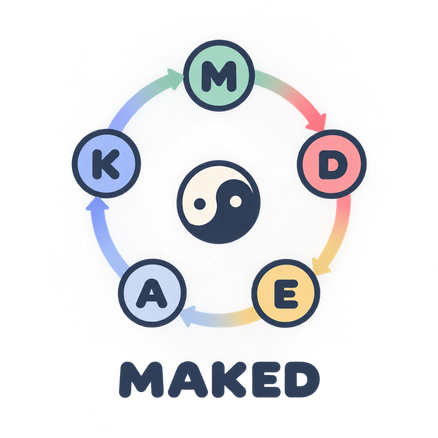

# MAKED



[](https://mooncakes.io/docs/riantr/MAKED)
[](https://github.com/riantr/MAKED/releases)
[](LICENSE)

**An adversarial knowledge loop that shows its working.**

Current release: **v0.1.8** — published as [`riantr/MAKED`](https://mooncakes.io/docs/riantr/MAKED@0.1.8) on mooncakes.io.

MAKED is a five-domain ring — **Model → Data → Experience → Attack → Knowledge** — in which
each domain is the adversarial overcoming of the one before it. The loop is driven by a
*transition table*: which slot can push a position is answered by the table, never by a
hard-coded guess, and a position the table cannot move is reported as blocked rather than
silently skipped.

One ring: **34 positions × 8 slots × 272 rules**. One subject per domain, one group
across the domains (20 states), one society for the collective (13 positions × 8 phases
× 28 transitions). And **229 mutations** across the three suites, every one of which has
to be accounted for — 228 killed by the tests, one deliberately equivalent.

Three layers sit on that ring:

| Layer | What it is |
|---|---|
| **Subject** | One state machine per domain — 34 positions × 8 slots × 272 rules, of which 228 have no way out |
| **Group** | Group states computed across the domains — Scattered → Converging → Common Tongue → Settled (20 states) |
| **Society** | The collective as a communicative whole — 13 positions × 8 phases × 28 transitions, from [riantr/pyroduct](https://mooncakes.io/docs/riantr/pyroduct@0.1.35) |

The state machine is `riantr/pyroduct@0.1.35`. The front end is
[rabbita](https://mooncakes.io/docs/moonbit-community/rabbita@0.17.0), the server is a
Flask-style micro-framework on [moonback](https://mooncakes.io/docs/moonbitlang/moonback@0.8.10),
and the storage is SQLite.

Everything a person would want to change is a **file**: the machine, the table that says what
a document means, the words for the collective, and the corpus the documents come from.
Everything another agent would want to drive is a **tool**: MAKED speaks the Model Context
Protocol over stdio or HTTP.

## Features

* **A five-domain ring**

  Model → Data → Experience → Attack → Knowledge, in that order, each domain
  initialising independently; the starting domain is one request away.

* **Drive slots from the transition table**

  Of the 272 position/slot pairs, 228 are `Block`; the loop reports "no way
  out" instead of pretending to move.

* **Undecided branches stay undecided**

  When the table offers several successors and none is preferred, MAKED lists
  them and lets the caller choose, and says which kind of edge each one is.

* **The reader chooses how the loop runs**

  The panel says which mode is in force (structured, which follows the ring, or
  free, which lets any slot drive) and lets the reader change it; a run can
  also be started again from any domain of the ring.

* **Your own records, and your own corrections**

  A record in the workspace can be written, corrected in place and removed; a
  correction keeps the record's number, its time and its place in the
  workspace's order.

* **The pages say what you say**

  A page can be corrected in place: the page keeps its place in the navigation,
  the correction is in the language you wrote it in, and it is still there
  after the server restarts.

* **The machine is a file**

  A model file (JSON or YAML) with its own domains, positions, slots and rules;
  `MAKED_MODEL` names it.

* **The mapping table is a file**

  The rules that say what a document means, read top down, first match wins;
  `MAKED_RESEARCH` names it.

* **The corpus is yours**

  A corpus of arxiv, of an RSS feed, or of your own folder of `.txt`, `.md`,
  `.markdown`, `.pdf` and `.json` files; `MAKED_CORPUS` names it.

* **The corpus says what it did not read**

  A corpus of two hundred read as twenty is not a corpus of twenty, so the
  panel, the drive and the causal estimate all say how many the corpus holds
  and how many were read.

* **The collective**

  The Society layer, with its 13 positions, 28 transitions and 8 phases; the
  English words are a file, so `MAKED_SOCIETY` can change them.

* **The collective's words are checked**

  A vocabulary that names a position the machine does not have is a gap, and
  the gaps are reported rather than papered over.

* **Causal estimates that say what they rest on**

  DoubleML, with the treatment, the outcome, the controlled variables, the
  balance table, the overlap and the sensitivity all reported.

* **Explorations you can take away**

  Named sessions whose every step records why it was possible; replay, branch,
  rename, and export as Markdown or JSON.

* **Two languages, written not translated**

  The loop, the timeline, the measures, the exported document and the pages
  themselves all answer in English or Chinese; the Chinese is the table's own
  wording.

* **An agent's server**

  The Model Context Protocol (2026-07-28) over stdio or HTTP, seven tools,
  every answer in sentences.

* **A discovery document**

  `GET /api/agent`, for an agent that does not speak the protocol: the same
  seven tools, the instructions, and the plain HTTP endpoints.

* **A browser front end**

  A rabbita single-page app served by the same process as the API; no second
  web server, no CORS configuration.

* **A file that cannot be read stops the start-up**

  A half-read machine answers every request confidently and wrongly, which is
  the worst thing a server can do.

## What you get

MAKED is a MoonBit module that ships two packages and three executables, and
it is used in three ways: as a library, as a server, and as an agent's server.

| You use | You get | Shape |
|---|---|---|
| `riantr/MAKED/backend` (native) and `riantr/MAKED/frontend` (js) | the loop, the API and the storage; the single-page app | two MoonBit packages |
| `cmd/server` | the API and the browser app in one process | HTTP |
| `cmd/mcp` | the agent's server | Model Context Protocol 2026-07-28, over stdio or HTTP |
| `GET /api/agent` | the discovery document: the seven tools, their argument schemas, the HTTP endpoints, the four files | JSON |
| `GET /api/model` | the machine as data: the domains, the positions, the slots, and the rule for every pair | JSON |
| `GET /api/sessions/:id/export` | one exploration, taken away | Markdown or JSON |

Every one of those is an explicit value, or a pure function of the files MAKED
runs on: there is no hidden global state and no clock in the answers, which is
why `moon test` can assert on them and why the gates can hold this document to
the tree.

The server and the agent's server are executables in this repository rather
than packages, because they are applications: they open a database and they
listen on a port.

## Install

### As a MoonBit package

```bash
moon add riantr/MAKED
```

Then add the package you want to your `moon.mod`:

```moonbit nocheck
///|
import {
  "riantr/MAKED/backend@0.1.8" @maked,
}
```

MAKED ships two packages: `riantr/MAKED/backend` (native — the loop, the API and the storage)
and `riantr/MAKED/frontend` (js — the single-page app). The server and the agent's server are
executables in this repository rather than packages, because they are applications: they
open a database and they listen on a port.

### As an application

The first barrier in this project is not the code, it is the installation: a MoonBit
toolchain, a C toolchain, and a build step. If you only want to *look* at MAKED, you should
have to install none of that.

```bash
docker compose up --build
```

Then open <http://127.0.0.1:8080/>. The image holds the server and the browser files it
serves; the database is created and seeded on first run and lives in a named volume, so your
records survive the container being replaced.

The image is also published, so the clone is not needed either:

```bash
docker run --rm -p 8080:8080 -v maked-data:/data ghcr.io/riantr/maked:latest
```

> A package on ghcr.io is private until someone says otherwise, and only the owner can say
> it: **Settings → Package settings → Change visibility → Public**, once, for `riantr/maked`.

Every release also carries a ready-to-run build for three platforms, with the browser files
beside the executable:

| Platform | Asset |
|---|---|
| Linux x86-64 | `maked-<version>-linux-x86_64.tar.gz` |
| macOS (Apple Silicon) | `maked-<version>-macos-arm64.tar.gz` |
| Windows x64 | `maked-<version>-windows-x64.zip` |

Unpack it, run the executable in that directory, and open <http://127.0.0.1:8080/>.
`RUN.txt` inside the archive says the same thing. Downloads:
<https://github.com/riantr/MAKED/releases>

### What the release was checked on

`moon 0.1.20261102` (`moonc v0.10.19`) — the toolchain this tree is written
against, and the one every number in this file was measured on.

The workflow installs the toolchain from the official install script, which
serves the **current** release, so the runner's version moves with it. The
tree and the toolchain move together: when upstream changed the spelling of
`derive`, the tree was reformatted to the new one rather than pinned to the
old, because a pinned toolchain is not installable — the release server
publishes `latest` and `nightly`, and every versioned path answers 403.

That is the toolchain this release was **verified** against, not a tested
**minimum**: no older toolchain has been exercised here, and quoting a lower
bound nobody ran would be a claim, not a fact.

The release is checked by six jobs, and the same six run on every push:

| Job | What it does |
|---|---|
| `Test` | the backend and the frontend suites |
| `Gates` | the formatter, the mutation anchors, the typos gate, and the two document gates |
| `Build (native)` | the server and the agent's server, released |
| `Build (js)` | the browser bundle |
| `Integration` | the suite against a server that is really running |
| `Container` | the image, pushed to `ghcr.io/riantr/maked` |

The dependencies were checked against the registry **before** the release, not
after: eight of them moved to their newest published versions, the whole gate
suite was run again with them, and this file was written afterwards. A release
measured against an older pin is a release measured against something nobody
ships.

That check now runs **inside the release**, and there it is a failure rather
than a warning. `tools/dep-check.sh --strict` asks the registry for the current
version of every dependency in `moon.mod`, and the release stops if one has
moved — or if one could not be read at all, because "could not be queried" is
not "is current", and a release that cannot check its dependencies should not
ship. On a push the same script stays a warning: a push should not go red
because somebody published a new version of a dependency an hour ago.

Every job that installs the toolchain refreshes the registry index with
`moon update` before it resolves anything, so the versions it builds against
are the ones the registry has now. Refreshing the index is not the same thing
as moving the pin: `moon update` leaves `moon.mod` where it is, and the
upgrade is `moon add --upgrade <package>@<version>` — a change to the tree,
which goes through the gates like any other.

### What changed in 0.1.8

Five changes, and **none of them breaks the published surface**:

- **The tree moved to the toolchain CI installs.** Upstream MoonBit shipped a
  release, and the formatter began to ask for a new spelling of `derive` — an
  attribute above the type rather than a clause on the closing brace. Fifty-
  eight types across ten backend files wanted to move, and the Gates job went
  red on a tree nobody had touched. The tree was reformatted with the current
  toolchain and the thirty-nine line claims the documents make were re-anchored
  to the lines the tree now holds.
- **The container builds the tree it is holding.** The toolchain was
  installed *before* the source was copied, so that layer was a cache hit and
  the image compiled today's tree with the compiler that was current when the
  cache was filled. It is installed after the source now, so the compiler in
  the image is always the one that built the source in it.
- **Eight dependencies moved to their latest published versions** — rabbita,
  async, moonback, pdflite, x, moonbit_doubleML, pyroduct and the MCP package
  — and the chain rule that reads moonback's middleware order was re-read
  rather than assumed to carry over.
- **Six guards that had stopped guarding were repointed.** An anchor is the
  line a mutation is applied to; six of them named a shape the code had left
  behind, so those mutations were never made and the suites reported a
  survivor that was really a claim about nothing. Each of the six was proved by
  breaking it on its own, and the 229 anchors are alive with none of them dead.
- **The typos gate runs.** It had stopped this account before, and it could
  not be run locally: the local typos is older than the version CI pins, and
  the newer one knows two words the older one does not — `ccontains`,
  PowerShell's case-sensitive contains operator, and `lits`, a local variable
  holding a line's literals. Neither is a misspelling, so both are
  whitelisted with the reason stated.

### Packages and targets

The module holds two packages and three executables. The **packages** are
libraries and are imported by name; the **executables** are applications and
are run.

| Package | Target | What it is |
|---|---|---|
| `riantr/MAKED/backend` | native | the loop, the API and the storage |
| `riantr/MAKED/frontend` | js | the single-page app |

| Executable | Target | What it is |
|---|---|---|
| `cmd/server` | native | the API and the browser app in one process |
| `cmd/mcp` | native | the agent's server, over stdio or HTTP |
| `cmd/web` | js | the browser bundle |

A module dependency and a package dependency are two different things, and the
toolchain is strict about it. `moon.mod` names the **module** and pins the
version it resolved; `moon.pkg` names the **package** inside a module and takes
**no version at all**. A version in a `moon.pkg` import is not a newer
spelling — it is an import the toolchain cannot find:

```
Cannot find import 'riantr/MAKED/backend@0.1.8' in my/app
```

For the same reason there is no `@latest`: the version is parsed as semver, so
`latest`, `^0.1.8`, `>=0.1.8` and `v0.1.8` are all rejected. A bare
`moon add riantr/MAKED` resolves the newest release and pins the concrete
version it found — that is the "latest" this toolchain has.

## The five domains

The ring has five domains and each one is the adversarial overcoming of the one
before it. The order is **M → D → E → A → K**, and the loop runs it as a ring
rather than a line: the starting domain is one request away from any other.

| Letter | Domain | What it holds |
|---|---|---|
| M | Model | the machine: the rules that say what may move where |
| D | Data | the corpus, and the mapping table that says what a document means |
| E | Experience | the runs: the explorations, their steps and their measures |
| A | Attack | the question the loop cannot answer, and the refusals it returns |
| K | Knowledge | what the ring has worked out, and what it writes down |

Each domain is a state machine of its own, and they initialise independently:
the pointer moves, the states do not reset. Whether a slot can push a position
is answered by the **transition table** and never by a hard-coded guess, and a
position the table cannot move is reported as blocked rather than silently
skipped. Of the 272 position/slot pairs, 228 are `Block`, and the loop says so
in words rather than pretending to move.

Three layers sit on that ring:

| Layer | What it is |
|---|---|
| **Subject** | one state machine per domain — the machine the loop runs on |
| **Group** | the group states computed across the domains — Scattered → Converging → Common Tongue → Settled |
| **Society** | the collective: its own vocabulary file, its own phases and its own moves |

The collective's words are a file (`MAKED_SOCIETY`), not a string in the
binary, and a vocabulary that names a position the machine does not have is a
gap the panel reports out loud.

The mark draws the same five letters, clockwise from the top: M at the top, D
at the right, E at the lower right, A at the lower left and K at the upper
left. The browser app draws it as SVG rather than as a bitmap, so it scales
and themes with the rest of the site.

## Running it

### Command line

```bash
# The web server: the API and the browser app, one process.
moon run --release --target native cmd/server

# The agent's server, over stdio. Spawn this; speak MCP to it.
moon run --release --target native cmd/mcp

# The agent's server, over HTTP, on the port you name.
MAKED_MCP_PORT=8735 moon run --release --target native cmd/mcp
```

From source, `build.ps1` builds the browser bundle, stages it where the server looks for it,
type-checks the backend, runs every test, and builds the server:

```powershell
.\build.ps1
moon run --release --target native cmd/server
```

## API Reference

### The HTTP API

| Method | Path | What it does |
|---|---|---|
| `GET` | `/api/status` | is the server up, how many pages, which domains |
| `GET` | `/api/pages` | the ten pages the server holds, in the language asked for |
| `GET` | `/api/pages/:slug` | one page by slug |
| `PUT` | `/api/pages/:slug` | correct what one page says |
| `GET` | `/api/domains` | the five domains in ring order |
| `GET` | `/api/bootstrap` | pages, workspace entries and session state in one call |
| `GET` | `/api/entries` | the workspace entries |
| `POST` | `/api/entries` | put your own record in the workspace |
| `PUT` | `/api/entries/:id` | correct one |
| `DELETE` | `/api/entries/:id` | remove one |
| `GET` | `/api/sessions` | the named explorations |
| `POST` | `/api/sessions` | start one |
| `GET` | `/api/sessions/:id` | one exploration, with its timeline |
| `POST` | `/api/sessions/:id/activate` | bring one to the front |
| `POST` | `/api/sessions/:id/replay` | re-run a run |
| `POST` | `/api/sessions/:id/branch` | fork an exploration |
| `POST` | `/api/sessions/:id/rename` | rename one |
| `DELETE` | `/api/sessions/:id` | delete one |
| `GET` | `/api/sessions/:id/export` | one exploration as `markdown` or `json` |
| `GET` | `/api/loop/status` | where the loop stands |
| `GET` | `/api/loop/slots` | the eight-slot vocabulary |
| `GET` | `/api/loop/continuations` | what the machine says could happen next |
| `GET` | `/api/loop/mode` | the current mode |
| `POST` | `/api/loop/mode/:mode` | change it |
| `POST` | `/api/loop/step/:slot` | take a move with a named slot |
| `POST` | `/api/loop/step` | take a move and let the table choose |
| `POST` | `/api/loop/reset` | back to Model with an empty history |
| `POST` | `/api/loop/reset/:domain` | back to a chosen domain |
| `GET` | `/api/model` | the machine as data |
| `GET` | `/api/agent` | the discovery document: the seven tools, the instructions, and the HTTP endpoints |
| `GET` | `/api/research/documents` | the documents the corpus holds |
| `POST` | `/api/research/drive` | drive a document through the loop |
| `GET` | `/api/research/config` | the mapping table, and whether it can be written back |
| `PUT` | `/api/research/config` | put a table of your own |
| `GET` | `/api/research/corpus` | the corpus, and whether it can be written back |
| `PUT` | `/api/research/corpus` | put a corpus of your own |
| `GET` | `/api/research/causal` | the causal estimate, and what it rests on |
| `GET` | `/api/society` | the collective: where it stands, what it can do |
| `POST` | `/api/society/step` | take a move for the collective |

### The language

The model has two vocabularies — the English reading MAKED was built with,
and the table's own Chinese — and the endpoints that answer about the loop,
the timeline, the research, the pages and the reader's own workspace take
`?lang=`:

| `?lang=` | What comes back |
|---|---|
| *(absent)* | English |
| `zh` | Chinese |

```
GET  /api/loop/status?lang=zh
GET  /api/loop/slots?lang=zh
GET  /api/loop/continuations?lang=zh
POST /api/loop/step?lang=zh
GET  /api/sessions/1?lang=zh
GET  /api/pages?lang=zh
GET  /api/pages/model?lang=zh
GET  /api/bootstrap?lang=zh
GET  /api/research/causal?lang=zh
POST /api/entries?lang=zh
PUT  /api/entries/1?lang=zh
PUT  /api/research/config?lang=zh
PUT  /api/research/corpus?lang=zh
```

The Chinese is the table's own rather than MAKED's translation of it: a
position is called 立位 because pyroduct calls it that, and the sentences are
written in Chinese rather than translated from the English ones.

`GET /api/model` needs no parameter, because the model carries both
vocabularies and a client can choose for itself. A model file with no
Chinese in it is still read, and a reader who asks for Chinese gets the
English names rather than a blank. That is the only rule about the fallback.

The collective (`/api/society`) answers in Chinese as well: its position
names, its glosses and its phases are pyroduct's own, because the
vocabulary file — the reader's own words — is written in English.

The measures and the export answer in Chinese as well, and the export is
the one that matters most: it is the thing the reader takes away, and it is
written twice rather than translated, because the shape of an English report
is not the shape a Chinese reader expects.

```
GET  /api/sessions/1/export?format=md&lang=zh
GET  /api/sessions/1/export?format=json&lang=zh
```

The measures are the same numbers in both languages — the measures read the
run, and the run does not change with the language — and the sentences
beside them are not. A reader who cannot read the sentence cannot trust the
number next to it.

The causal estimate answers in the language asked for as well: the treatment it
names, the outcome it scores, the variables it controls for, the reading of the
overlap and the reading of the sensitivity are all written in the language the
request named — and so is a refusal, because a refusal is a sentence too. The
numbers are the same in both languages; the corpus does not change with the
language.

A refusal is in the language asked for on the write paths too. When a record
is refused because its domain is not one of the five, when a mapping table is
refused because it names a slot the model does not have, when a corpus is
refused because it names a source it cannot read — the reason says what is
wrong in the language the request named, because that reason is the one answer
a person who has just typed something wrong is guaranteed to read, and the one
that says what to change.

The agent's server takes the same switch as an argument: `maked_status`,
`maked_options`, `maked_step`, `maked_society`, `maked_sessions` and
`maked_export` all accept `lang`.

### The language in the browser

The page has a switch too, at the top right of the header. It names the
language it switches *to*, so a reader who cannot read the language in force
can still read the button. Pressing it moves the whole interface: the words
the client owns come from the client's own table, and the words the machine
owns come back from the server in the language that was asked for.

The choice is not remembered across a reload. It is a question the reader
asks of the page, and a page that has just been opened has not been asked.
The export links carry the language with them, so the document a reader
downloads is in the language the page is in.

There is nothing left in English for a reader to work around. The pages are
written in both languages and the server sends the one that was asked for, so
the prose of the five domain pages is Chinese in a Chinese interface. That
prose is the project's own writing rather than the machine's, which is why it
lives in the database beside the English of it.

### The agent's server

Seven tools. Every answer is in sentences, with the ids beside them for when you want to be
exact.

| Tool | Arguments | What it answers |
|---|---|---|
| `maked_status` | `lang` | where the loop stands, what the last move did, what the run adds up to, whether it is still finding ground |
| `maked_options` | `depth`, `lang` | the slots that can move, the slots that cannot and why, the successors the table declined to choose between |
| `maked_step` | `slot`, `target`, `lang` | take a move, and say what happened |
| `maked_model` | — | the machine as data: domains, positions, slots, and the rule for every pair |
| `maked_society` | `trigger`, `lang` | where the collective stands; with a trigger, take that move |
| `maked_sessions` | `lang` | the named explorations, and which one is in front of us |
| `maked_export` | `session_id`, `format`, `lang` | one exploration as Markdown (to read) or JSON (to process) |

The suggested order is: `maked_status` → `maked_options` → `maked_step`. `maked_step` with
no slot lets the table choose; with a slot you choose; with a `target` you answer a question
the table asked.

### The discovery document

`GET /api/agent` is the same information for an agent that does not speak the Model Context
Protocol — or that has never heard of it. It carries the seven tools with their argument
schemas, the instructions for calling them, the plain HTTP endpoints that ask the same
questions, and the four files MAKED runs on.

```bash
curl -s http://127.0.0.1:8080/api/agent
```

The tool list in the document and the tool list the protocol server offers come from one
place in the code, and the integration suite compares them against the running server — two
lists of tools are two lists of tools, and the one that drifts is the one nobody is looking
at.

The same material is in **[AGENT.md](AGENT.md)**, for an agent that reads the repository
rather than the server. The integration suite checks that it names the same seven tools.

### The four files

| File | Format | Named by | What it decides |
|---|---|---|---|
| The machine | `maked.model.v1` (JSON or YAML) | `MAKED_MODEL` | the domains, positions, slots and rules the loop runs on |
| The mapping table | `maked.research.v1` (JSON or YAML) | `MAKED_RESEARCH` | what a document means — which words make a rule fire, and which slot it drives |
| The society vocabulary | `maked.society.v1` (YAML) | `MAKED_SOCIETY` | the English words for the collective's positions and moves |
| The corpus | `maked.corpus.v1` (YAML) | `MAKED_CORPUS` | where the documents come from: arxiv, an RSS feed, or your own folder |

A `.yaml` or `.yml` file is read as YAML; every other file is read as JSON. The extension
decides, because a file written in one and read as the other is a file that half-reads.

### Environment Variables

| Variable | Default | Meaning |
|---|---|---|
| `MAKED_PORT` | `8080` | listen port |
| `MAKED_HOST` | `127.0.0.1` | listen address — `0.0.0.0` to be reachable from other machines |
| `MAKED_DB` | `maked.db` | SQLite file path |
| `MAKED_DIST` | `frontend/dist` | frontend build output directory |
| `MAKED_MODEL` | *(unset)* | a machine to run instead of the built-in one |
| `MAKED_RESEARCH` | *(unset)* | a mapping table that says what a document means |
| `MAKED_CORPUS` | *(unset)* | a corpus file: where the documents come from |
| `MAKED_SOCIETY` | *(unset)* | a vocabulary file: the English words for the collective |
| `MAKED_MCP_PORT` | *(unset)* | a port: the agent's server speaks HTTP instead of stdio |

An empty value counts as unset, because an empty environment variable is a mistake rather
than a filename.

### Error handling

There is no auth. That is a real limitation rather than an oversight, and it is stated here
because it is the first thing to change before this is exposed beyond a local process:
anyone who can reach the port can read and delete every entry.

Apart from that, the rules are these:

- **A refused request is an answer, not a crash.** A slot that does not exist comes back as
  `400` with the name of the slot that was asked for. A step that cannot move comes back
  with the reason it cannot, in words.
- **A file that cannot be read stops the start-up.** The reason is printed on stderr, and
  the server does not serve. Unset the variable that names it to run the built-in one.
- **A rule that names a slot the machine does not have is refused.** It is a rule about
  nowhere, and reading it would mean inventing a slot to hold it.
- **A vocabulary that names a position the collective does not have is a gap.** The gaps are
  reported, in the panel and in the API.

## Project Structure

```
MAKED_moonbit/
├── backend/                          # the loop, the API and the storage (native)
│   ├── model.mbt                     # the machine: domains, positions, slots, rules
│   ├── loop.mbt                      # the subject loop and the group states
│   ├── society.mbt                   # the collective
│   ├── step.mbt                      # one step, shared by the API and the agent
│   ├── agent.mbt                     # the agent's payloads, in sentences, and the discovery document
│   ├── bootstrap.mbt                 # the start-up: plan → read → install
│   ├── version.mbt                   # the version the agent reports
│   ├── api.mbt                       # every HTTP route
│   ├── app.mbt                       # the Flask-style app: the route table and the middleware chain
│   ├── maked_app.mbt                 # the app, assembled
│   ├── request.mbt                   # the request wrapper
│   ├── response.mbt                  # the response helpers
│   ├── pages.mbt                     # the content model, and the ten public pages
│   ├── entries.mbt                   # the workspace: the things the reader brings
│   ├── research_config.mbt           # the mapping table
│   ├── research.mbt                  # what a document means
│   ├── corpus.mbt                    # the corpus
│   ├── corpus_sources.mbt            # where the documents come from: arxiv, a feed, a folder
│   ├── datafile.mbt                  # a file that may be JSON or YAML
│   ├── causal.mbt                    # the causal estimate
│   ├── narration.mbt                 # the sentences
│   ├── i18n.mbt                      # the language switch
│   ├── export_words.mbt              # the exported document's words, in both languages
│   ├── metrics.mbt                   # the measures, in both languages
│   ├── session.mbt                   # explorations, timelines, exports
│   ├── database.mbt                  # SQLite
│   ├── *_test.mbt                    # 454 tests
│   └── *_wbtest.mbt                  # 16 tests
├── frontend/                         # the single-page app (js)
│   ├── app.mbt                       # the TEA loop and the messages
│   ├── i18n.mbt                      # the words the client owns
│   ├── loop_state.mbt                # the loop's state, and why a step may do nothing
│   ├── society.mbt                   # the society panel
│   ├── session.mbt                   # the explorations panel
│   ├── entries.mbt                   # the workspace panel
│   ├── causal.mbt                    # the causal panel
│   ├── page.mbt                      # the page, and how it is decoded
│   ├── logo.mbt                      # the ring
│   ├── views.mbt                     # the views
│   └── frontend_test.mbt             # 174 tests
├── cmd/
│   ├── server/main.mbt               # the web server
│   ├── mcp/main.mbt                  # the agent's server
│   └── web/main.mbt                  # the browser bundle
├── models/                           # example machines
│   ├── product-iteration.json
│   └── product-iteration.yaml
├── research/                         # example tables, corpora and vocabularies
│   ├── product-iteration.yaml
│   ├── society.yaml
│   ├── corpus-arxiv.yaml
│   ├── corpus-local.yaml
│   └── notes/                        # the corpus the local example names
│       └── failed-launch.md
├── tools/
│   ├── integration-test.ps1          # 465 checks against a running server
│   ├── mutate-backend.ps1            # 148 mutations of the backend
│   ├── mutate-frontend.ps1           # 65 mutations of the frontend
│   ├── mutate-loop.ps1               # 16 mutations of the loop
│   ├── check-mutation-anchors.ps1    # 229 anchors, and whether any is dead
│   ├── check-readme.ps1              # the claims this document states, against the tree
│   ├── check-readme.sh               # the same gate, in bash
│   ├── check-docs.ps1                # the other documents' claims, against the tree
│   └── check-docs.sh                 # the same gate, in bash
├── .githooks/                        # the pre-commit hook, and the note beside it
│   ├── pre-commit                    # the hook itself
│   └── README.md                     # what it runs, and how to install it
├── AGENT.md                         # how to drive MAKED from another agent
├── AGENTS.md                        # how to work on MAKED
├── maked.png                        # the logo, at the size the README shows it
├── maked_Logo.png                   # the same mark, at full resolution
├── moon.mod  moon.pkg
├── build.ps1                         # build the bundle, check, test, build the server
├── ci.sh                             # 18 gates
└── Dockerfile  docker-compose.yml
```

## Usage Tips

### Start the loop anywhere

The loop may start at any domain; the starting domain is one request away:

```bash
curl -X POST http://127.0.0.1:8080/api/loop/reset/knowledge
```

The five domains are `model`, `data`, `experience`, `attack` and `knowledge`. Each domain's
state machine initialises independently — only the pointer moves.

### Ask before you move

`GET /api/loop/status` carries the slots that are open from where the loop stands, and
`GET /api/loop/continuations` tells you what the machine says could happen next and how
far away it is. The same information in one place, with the reason each slot cannot move,
is what the agent gets from `maked_options`.

### Read the run as numbers

Every session carries five measures: `New ground`, `Settling`, `Slots used`, `Domains visited`
and `Positions covered`. They are reported together with the comparison of the last window of
steps against the first, so a measure can be checked rather than believed.

### Keep the table and the machine together

A machine of your own has slots of your own, and the built-in table names slots it does not
have. MAKED says so at start-up — but the panel stays quiet until you give it a table that
fits. Keep the two files next to each other, and set both variables.

## Common Pitfalls and Best Practices

### ✅ DO:

1. **Give the machine and the table together.** A table whose rules name slots the running
   machine does not have is refused at start-up, on purpose.

   ```bash
   MAKED_MODEL=models/product-iteration.json \
   MAKED_RESEARCH=research/product-iteration.yaml \
   moon run --release --target native cmd/server
   ```

2. **Ask what the table offers before taking a move.** `maked_options` lists the slots that
   can move and the ones that cannot, and says why. A slot with no road out of a position is
   not a failure of the caller.

3. **Let an undecided branch stay undecided.** When the table offers several successors and
   none is preferred, take the target as an argument rather than picking one for the
   subject.

4. **Read a refusal as an answer.** A refused request comes back with the reason, in words,
   and names the thing that was asked for.

### ❌ DON'T:

1. **Don't treat the ring order as evidence that anything moved.** The ring order
   M → D → E → A → K is the order the logo draws. It is presentation, not state.

2. **Don't mix the protocols on one stream.** The agent's server speaks MCP on stdout.
   Diagnostics belong on stderr — a line of prose in the middle of a protocol stream is a
   line the client cannot parse, and the reason MAKED refused to start is lost in the noise.

3. **Don't read a file you cannot read whole.** MAKED refuses a file it cannot read rather
   than half-reading it, and the start-up stops. Keep that: a half-read machine answers
   every request confidently and wrongly.

4. **Don't hand a table to a machine it does not fit.** A rule that names a slot the
   machine does not have is a rule about nowhere, and reading it would mean inventing a slot
   to hold it.

## Roadmap

- [x] The five-domain ring, with the drive slots taken from the transition table
- [x] The machine as a file
- [x] The mapping table as a file
- [x] The corpus as a file
- [x] The collective, and its words as a file
- [x] Causal estimates that report what they rest on
- [x] Explorations: replay, branch, rename, export
- [x] The agent's server — Model Context Protocol over stdio and HTTP
- [x] A discovery document at `GET /api/agent`, for agents that do not speak MCP
- [x] A Chinese front end
- [x] The measures and the exported document in two languages
- [x] The pages in two languages, and no longer describing a program that is not this one

## Contributing

1. Fork the repository
2. Create a feature branch
3. Add tests for new behaviour
4. Ensure all gates pass with `bash ci.sh`
5. Submit a pull request

The contributor's guide is [AGENTS.md](AGENTS.md): what the gates check, how the mutation
batteries work, and the pre-commit hook.

The gates that matter most are the two that check the tests themselves: `moon fmt --check`
(the formatter rewrites the source, and a mutation anchor that pointed at a line the
formatter has since re-wrapped stops matching — the mutation then never happens and the
suite reports a survivor that is really a claim about nothing), and
`tools/check-mutation-anchors.ps1` (an anchor that does not occur in the file is a guard
that cannot fail).

Contributions should keep the three rules that the rest of the project rests on: a file that
cannot be read is refused rather than half-read; a rule that names a slot the machine does
not have is refused; and an answer that is a refusal says why, in words.

## Quick Start

Two ways in: the loop in a browser, and the agent's server over the Model
Context Protocol. Both are the same machine; the second one just speaks the
protocol an agent speaks.

### Run the loop

```bash
docker compose up --build
```

Open <http://127.0.0.1:8080/>. The panel shows where the loop stands, what the last move
did in words, and which slots the table offers from here. Take a move, and the run is written
down — every step with the reason it was possible.

### Run it from another agent

The short version:

```bash
curl -s http://127.0.0.1:8080/api/agent
```

That is the discovery document: the seven tools with their argument schemas, the
instructions for calling them, the plain HTTP endpoints that ask the same questions, and the
four files MAKED runs on. An agent that reads it needs nothing else.

MAKED also speaks the Model Context Protocol, version **2026-07-28**. Build the agent's
server and point your agent at it:

```bash
moon build --release --target native cmd/mcp
```

```json
{
  "mcpServers": {
    "maked": {
      "command": "/path/to/MAKED_moonbit/_build/native/release/build/cmd/mcp/mcp.exe"
    }
  }
}
```

The agent's server speaks stdio by default; set `MAKED_MCP_PORT` and it speaks HTTP
instead, on the port you name.

> The agent's server is **not** in the published release artifacts yet — those carry the
> web server and the browser bundle. It is built from this repository, and it will join the
> release when it is worth shipping.

Two things about this protocol version are worth knowing before you wire it up:

- **There is no handshake.** `initialize` is not a method in 2026-07-28; the server answers
  it with `-32601 Method not found`. The entry point is `server/discover`.
- **Every request carries its own version.** Each request's `params._meta` must contain
  `io.modelcontextprotocol/protocolVersion` (a string) and
  `io.modelcontextprotocol/clientCapabilities` (an object). A request without them is
  refused with `-32602`.

Over HTTP there are two more: the `MCP-Protocol-Version: 2026-07-28` header, and an
`Mcp-Method: <method>` header naming the method the body carries.

### Write a machine of your own

```bash
MAKED_MODEL=models/product-iteration.json \
MAKED_RESEARCH=research/product-iteration.yaml \
moon run --release --target native cmd/server
```

The loop now runs on *your* domains, positions and slots — and the table is read against
*your* machine, so a rule that names a slot your machine does not have is refused at
start-up rather than ignored.

## Example

Every one of these is a file you write yourself, and every one of them is
refused when it does not fit the machine it is run against — which is the
point: a table that names a slot the running machine does not have is a rule
about nowhere.

### A machine of your own

```json
{
  "format": "maked.model.v1",
  "name": "One small machine",
  "domains": [
    { "id": "idea", "letter": "I", "title": "Idea", "role": "the idea", "anchor": "raw" }
  ],
  "positions": [
    { "id": "raw", "label": "Raw idea", "gloss": "Nobody has built it yet.", "domain": "idea" },
    { "id": "asked", "label": "A question asked", "gloss": "Somebody was asked.", "domain": "idea" }
  ],
  "slots": [
    { "id": "ask", "designation": "Ask", "gloss": "Talk to somebody who would use it." }
  ],
  "rules": [
    {
      "from": "raw",
      "slot": "ask",
      "outcome": { "kind": "moved", "edge": "A customer said no", "to": "asked" }
    }
  ]
}
```

The example that ships with the repository is `models/product-iteration.json`: three domains,
seven positions, four slots. It is a complete machine, not a fragment. A rule that names a
position or a slot the machine does not define is refused at start-up, and so is a domain
whose anchor is not a defined position — such a domain starts nowhere.

### A mapping table of your own

```yaml
format: maked.research.v1
mapping:
  - label: A question worth asking
    keywords:
      - question
      - why
      - unclear
    slot: ask
    notes: The document opens a question rather than answering one.
fallback:
  label: Anything else
  slot: ask
```

The order is the priority: the table is read from the top and the first rule that matches
wins. A rule that names a slot the running machine does not have is refused at start-up.

### A corpus of your own

```yaml
format: maked.corpus.v1
source:
  kind: local
  path: ./notes
  max_results: 20
```

`kind` is `arxiv`, `rss` or `local`. A local corpus is a folder of the reader's own
files: `.txt`, `.md`, `.markdown`, `.pdf` and `.json`. A `.json` file is read as a
Zotero export, and a `.pdf` is read as the text of its pages. MAKED reads them, and
the documents it read are the ones it drives.

### A vocabulary of your own

`research/society.yaml` names the collective's 13 positions, 8 phases and 18 triggers in
English. The ids are pyroduct's own names — an id the file names that pyroduct does not
define is refused, and a position pyroduct defines that the file does not name is a gap the
panel says out loud.

### A record of your own

The pages are the server's and the records are yours: the workspace is the one part of the
server a reader is meant to change. A record is a domain letter, a title and a body:

```bash
curl -X POST http://127.0.0.1:8080/api/entries \
  -H 'Content-Type: application/json' \
  -d '{"domain": "M", "title": "The failure I want to keep", "body": "The loop reached a position it could not leave."}'
```

The domain is one of `M`, `D`, `E`, `A`, `K` — the ring's own letters — and the server
assigns the number and the time. A record is refused, with the reason, when the domain is
not one of the five, when the title is empty, when the title is longer than 200 characters,
or when the body is longer than 20,000.

A record can also be corrected, and it stays the same record — the same number, the same
place in the workspace's order, the same time:

```bash
curl -X PUT http://127.0.0.1:8080/api/entries/1 \
  -H 'Content-Type: application/json' \
  -d '{"domain": "M", "title": "The failure I want to keep, corrected", "body": "The loop reached a position it could not leave."}'
```

The same rules apply to a correction as to a new record: a change the create path would
refuse is not a change, and a record that is not there cannot be corrected.

### Correcting a page

The pages were the project's own words, seeded on every start-up, and there was no way to
change them — so "editable content" meant the workspace and nothing else. A page can now
be corrected too, and the correction is stored beside the seeded words rather than over
them, so it survives the next start-up:

```bash
curl -X PUT http://127.0.0.1:8080/api/pages/model \
  -H 'Content-Type: application/json' \
  -d '{"title": "The model I read it as", "body": "What the model is, in my own words."}'
```

What a correction may change is what the page *says*: its title and its body. The slug,
the letter, the role and the place in the navigation are the site's shape, and a reader
who could move a page into the navigation bar would be editing the site rather than its
content.

A correction belongs to the language it was made in, because a page is said twice:

```bash
curl -X PUT 'http://127.0.0.1:8080/api/pages/model?lang=zh' \
  -H 'Content-Type: application/json' \
  -d '{"title": "我读出来的模型", "body": "用我自己的话说。"}'
```

The English page keeps the English prose until it is corrected in English too. The answer
says whose words these are — the page carries a `corrected` flag and the time of the
correction — and the reader's own words are shown as text, never as markup, because they
are the reader's and not the project's.

A correction needs a title: a page with no name is not a page. A page that is not there
cannot be corrected, and the refusal says which one is missing.

### Driving it from another agent

```bash
$ MAKED_MCP_PORT=8735 moon run --release --target native cmd/mcp &
$ curl -s http://127.0.0.1:8735/mcp \
    -H 'MCP-Protocol-Version: 2026-07-28' \
    -H 'Mcp-Method: tools/list' \
    -H 'Content-Type: application/json' \
    -d '{"jsonrpc":"2.0","id":1,"method":"tools/list","params":{"_meta":{"io.modelcontextprotocol/protocolVersion":"2026-07-28","io.modelcontextprotocol/clientCapabilities":{}}}}'
```

## Gates and drift detectors

`moon fmt --check`, the two `moon check` targets, the backend and the frontend
suites, and `typos` on the prose are the baseline. The rest run on top of that,
because a green suite says nothing about a claim written in prose:

| Detector | Catches |
|---|---|
| `tools/check-readme.sh` and `tools/check-readme.ps1` | a number, a listing or a path this file states and the tree does not have |
| `tools/check-docs.sh` and `tools/check-docs.ps1` | the same, for the architecture documents, their graphs and their evidence tables |
| `tools/check-mutation-anchors.ps1` | an anchor that names a line the code has left behind — a guard that cannot fail, and a survivor that means nothing |
| `tools/mutate-backend.ps1`, `tools/mutate-frontend.ps1`, `tools/mutate-loop.ps1` | a behaviour the tests do not pin: every mutation has to be killed, and one that survives has to be accounted for |
| `tools/integration-test.ps1` | a claim about the running server, checked against a server that is really running |
| `tools/dep-check.sh` | a pin that has moved under the version that names it — a warning on a push, a failure on a release |

The two document gates are twins: the same invariant written twice, once in
bash and once in PowerShell, because the CI runner is ubuntu and carries bash,
and a gate written only in PowerShell is a gate that does not run where the
build runs. Both print the same lines and they go red together.

**Current release**: v0.1.8 · **Repository**: <https://github.com/riantr/MAKED>

### Test and gate counts

| What | How many | How it is checked |
|---|---|---|
| Backend tests | 470 | `moon test --target native backend` |
| Frontend tests | 174 | `moon test --target js frontend` |
| Integration checks | 465 | `tools/integration-test.ps1` — against a server that is really running |
| Backend mutations | 148 | `tools/mutate-backend.ps1` |
| Frontend mutations | 65 | `tools/mutate-frontend.ps1` |
| Loop mutations | 16 | `tools/mutate-loop.ps1` |
| Mutation anchors | 229 | `tools/check-mutation-anchors.ps1` — and whether any is dead |
| CI gates | 18 | `ci.sh` |

### Running the tests

```bash
moon check --target native          # type-check the backend
moon fmt --check                    # the formatter is a gate
moon test --target native backend   # the backend
moon test --target js frontend      # the frontend
bash ci.sh                          # everything, including the slow gates
```

## Used By

- `riantr/MAKED/backend` and `riantr/MAKED/frontend` — the two packages, used as
  a library: the loop, the API and the storage on one side, the single-page app
  on the other.
- `cmd/server`, `cmd/mcp` and `cmd/web` — the three executables in this module:
  the web server, the agent's server, and the browser bundle.
- [riantr/pyroduct](https://mooncakes.io/docs/riantr/pyroduct@0.1.35) — the
  state machine, the group states and the collective that the ring runs on.
- [riantr/moonbit_doubleML](https://mooncakes.io/docs/riantr/moonbit_doubleML@0.164.62) —
  the causal estimate.

Outside this repository: **none that the registry knows about.** The registry
lists **0 dependents** for `riantr/MAKED`, and nothing is claimed here that
cannot be named.

## Attribution

- License: MIT (see `LICENSE`).
- The state machine, the group states and the collective are
  [riantr/pyroduct](https://mooncakes.io/docs/riantr/pyroduct@0.1.35), and
  MAKED is the ring that runs on them.
- The front end is [rabbita](https://mooncakes.io/docs/moonbit-community/rabbita@0.17.0),
  and the HTTP server the micro-framework sits on is
  [moonback](https://mooncakes.io/docs/moonbitlang/moonback@0.8.10).
- The causal estimate is
  [riantr/moonbit_doubleML](https://mooncakes.io/docs/riantr/moonbit_doubleML@0.164.62).
- The protocol the agent's server speaks is the
  [Model Context Protocol](https://modelcontextprotocol.io), version 2026-07-28.
- The language is the [MoonBit Language Guide](https://www.moonbitlang.com/docs/).

## License

MIT License. See [LICENSE](LICENSE) for details.
